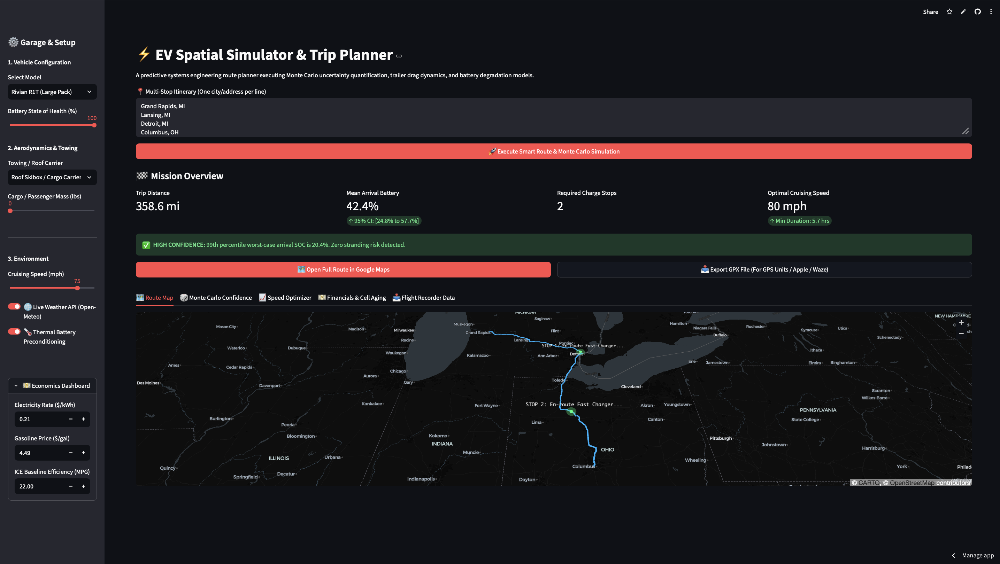

# ⚡ EV Spatial Routing & Systems Simulator

[](https://www.python.org/)
[](https://streamlit.io/)
[](https://ev-systems-planner.streamlit.app) 

[](https://ev-systems-planner.streamlit.app)



A production-grade Python application utilizing topographical numerical integration, stochastic Monte Carlo simulations, and real-time APIs to model Electric Vehicle (EV) kinetic resistance, thermodynamics, and battery degradation over spatial routes. 

Designed as a superior alternative to static route planners, this tool transforms theoretical physics into actionable, probabilistic trip data with multi-platform GPS exporting.

---

## 🏗️ System Architecture & API Integrations

The application operates on a state-space integration loop, calculating energy draw across discrete spatial segments (~100 nodes per route). It integrates four live external APIs:
1. **OSRM (Open Source Routing Machine):** Generates the multi-waypoint geographic polyline (GPS coordinates and distances).
2. **Open-Meteo API:** Injects real-time local weather data (temperature, wind vectors) and spatial topography maps for elevation changes.
3. **NREL (National Renewable Energy Lab) API:** Pings the U.S. Department of Energy database to proactively route the vehicle to the nearest verified DC Fast Charger when the battery drops below 15%.
4. **Dual-Engine Geocoding:** Utilizes a resilient Photon/OpenStreetMap primary engine with Nominatim fallback and automatic state abbreviation expansion to process fuzzy geographic inputs without failing.

---

## 📐 The Physics Engine (Numerical Integration)

For every segment between two GPS nodes, the software calculates the exact mechanical power required to move the vehicle.

### 1. Aerodynamic Drag
Calculates the power required to push the vehicle through the air. Incorporates live headwind vectors and variable air density based on current temperature. Towing profiles dynamically increase the drag coefficient (Cd) and frontal area.
* **Equation:** `Power = 0.5 * Air_Density * Total_Cd * Total_Area * (Air_Velocity^2) * Ground_Velocity`

### 2. Rolling Resistance
Calculates the friction between the tires and the road. Total mass dynamically scales based on user payload inputs (passengers, cargo, or trailers).
* **Equation:** `Power = Rolling_Coefficient * Total_Mass * Gravity * Ground_Velocity * cos(Incline_Angle)`

### 3. Gravitational Grade Resistance
Calculates the energy required to climb an elevation change, or the potential energy recovered when driving downhill. 
* **Equation:** `Power = Total_Mass * Gravity * Ground_Velocity * sin(Incline_Angle)`

### 4. Regenerative Braking (BMS Tapering)
When descending a mountain, kinetic energy is recaptured. The engine applies an advanced Battery Management System (BMS) constraint: regenerative charging efficiency smoothly tapers to 0% as the battery approaches 100% State of Charge (SOC) to prevent cell overvoltage.

---

## 🧬 Advanced Engineering Modules

### 🗺️ Dynamic Mapping & Navigation Export
Replaces static map views with sub-meter GPS pinpoints. The engine calculates the geometric centroid of the polyline to dynamically frame and zoom the viewport. Planners can export the final calculated route via **GPX XML files** for dedicated GPS hardware or click directly into **Google Maps deep links** for live mobile navigation.

### 🎲 Monte Carlo Confidence Engine
Static route planners fail when wind gusts or temperature drops occur. This application runs **100 parallel stochastic passes** using Gaussian distributions for driver speed variance, temperature fluctuations, and wind gusts. It outputs a 95% Confidence Interval for arrival battery and calculates a strict stranding probability.

### 📈 Cruising Speed Optimizer
Driving 80 mph instead of 68 mph exponentially increases energy draw due to aerodynamic drag, forcing extra charging stops. The software sweeps speeds from 55 to 85 mph, modeling both drive time and fast-charging lag, plotting the exact mathematical sweet spot for the shortest overall journey.

### 💵 Electrochemical Cell Aging & TCO Model
Fast charging degrades lithium-ion cells. The app models the hidden Total Cost of Ownership (TCO) by calculating cell wear cost ($0.035 per kWh throughput equivalent) alongside regional electricity rates, benchmarking it against a customizable ICE (Internal Combustion Engine) vehicle baseline for operational context.

---

## 🛠️ Local Installation & Execution

1. **Clone the repository:**
   ```bash
   git clone [https://github.com/YOUR-USERNAME/ev-systems-planner.git](https://github.com/YOUR-USERNAME/ev-systems-planner.git)
   cd ev-systems-planner